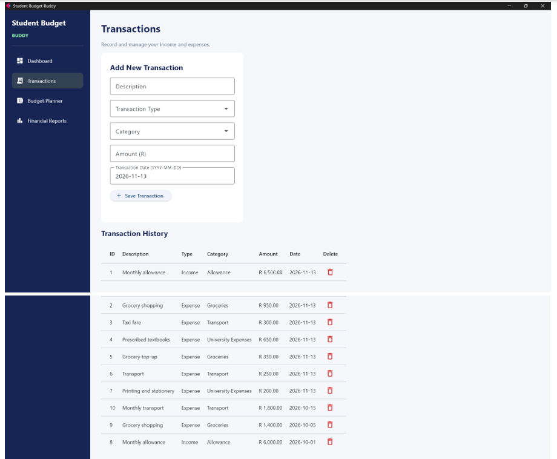
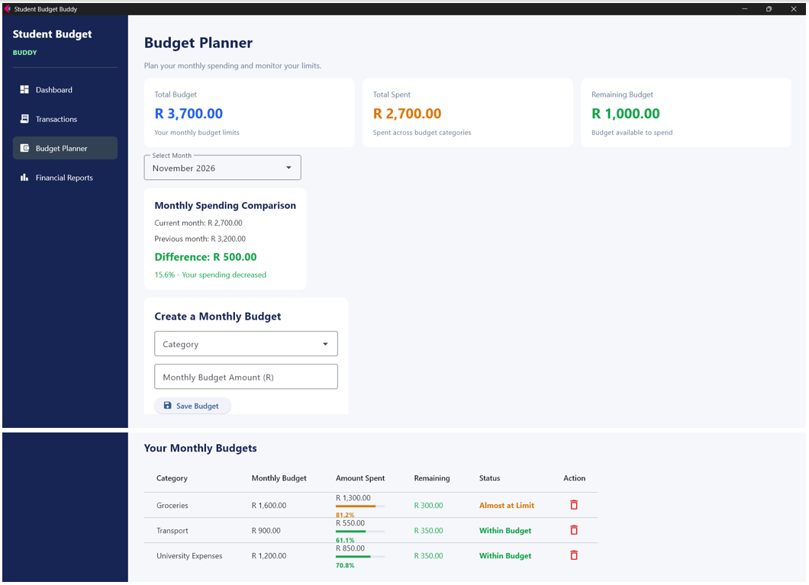
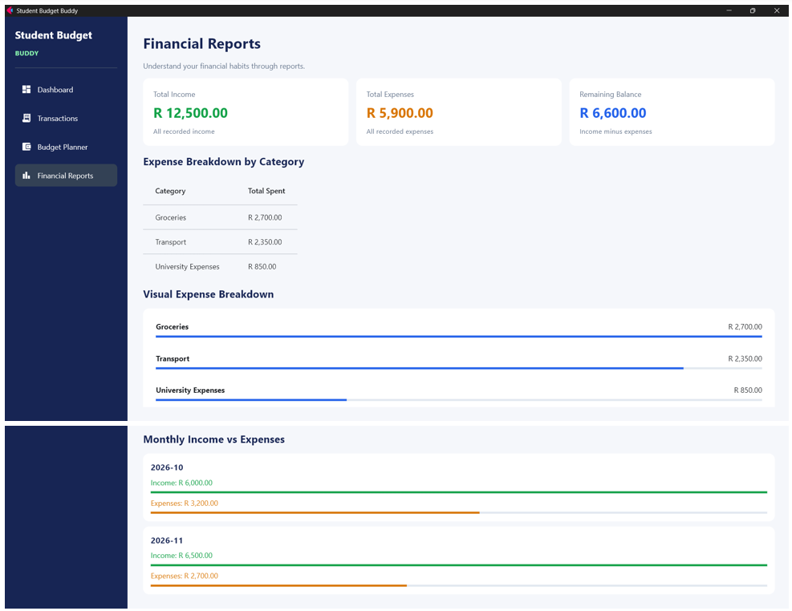

# Student Budget Buddy

## Project Overview

Student Budget Buddy is a Python-based personal finance management application developed to help university students manage their income, track expenses and plan their monthly budgets.

The application provides a central place for students to record financial transactions, monitor spending habits and understand their financial position.

## Features

- **Dashboard:** Displays total income, total expenses and remaining balance.
- **Transaction Management:** Allows users to record income and expenses, view transaction history and delete transactions.
- **Budget Planner:** Allows users to create monthly budgets for different spending categories.
- **Budget Tracking:** Displays spending progress, remaining budget and budget status.
- **Monthly Spending Comparison:** Compares expenses between the current month and previous month.
- **Financial Reports:** Provides expense breakdowns by category and monthly income-versus-expense comparisons.
- **Data Storage:** Uses SQLite to store transactions and budgets.

## Screenshots

### Dashboard

### Transaction Management

### Budget Planner

### Financial Reports

## Technologies Used

- Python
- Flet
- SQLite
- SQL

## Project Structure

STUDENT-BUDGET-BUDDY-WEB/
│
├── main.py
├── database.py
├── calculations.py
├── requirements.txt
├── README.md
└── .gitignore

## Installation and Setup

### 1. Install Python

Ensure that Python is installed on your computer.

### 2. Create a virtual environment

python -m venv venv

### 3. Activate the virtual environment

Windows:

venv\Scripts\activate
.\venv\Scripts\Activate.ps1

### 4. Install dependencies

pip install -r requirements.txt

### 5. Run the application

flet run --web main.py

## Database

Student Budget Buddy uses SQLite for data storage. The database stores transaction records and monthly budget information. The SQLite database and required tables are automatically created when the application starts. Users can begin recording transactions without manually creating a database.

## Purpose

This project was developed as part of the FNB Academy Programme to apply programming, database management and application development concepts to a practical problem affecting university students.

### AI Assistance Acknowledgement
This project was developed by me with assistance from ChatGPT (OpenAI), which I used as a support tool for understanding Python and Flet concepts, troubleshooting errors, and improving my code. I was responsible for the project's implementation, testing, and final decisions.